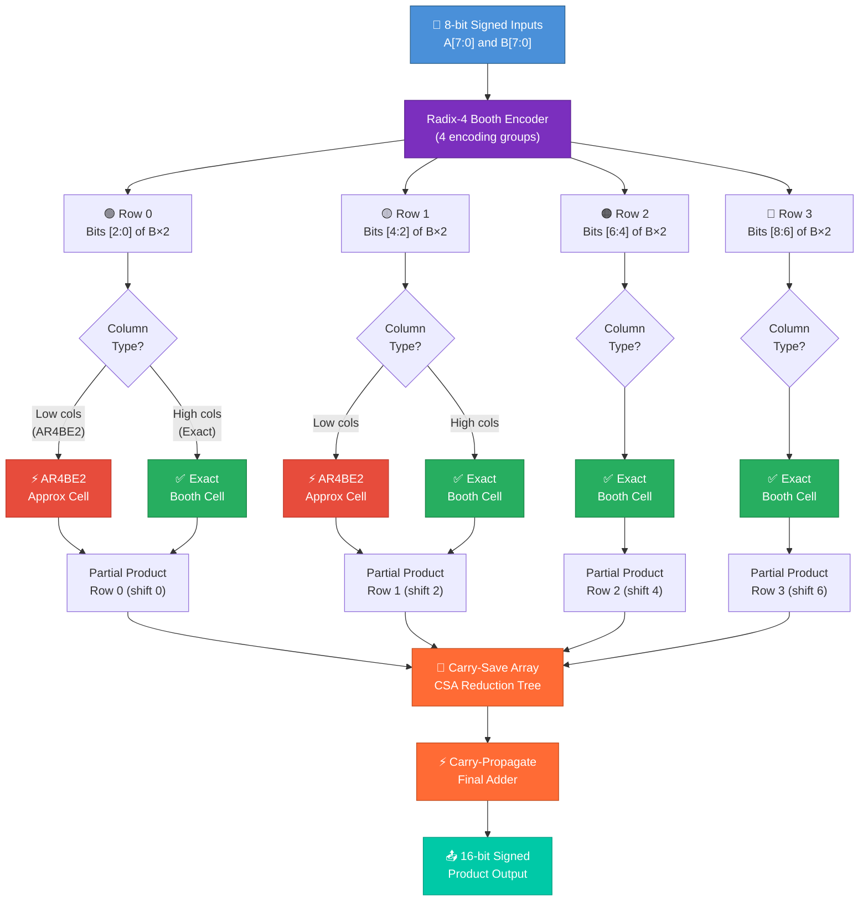
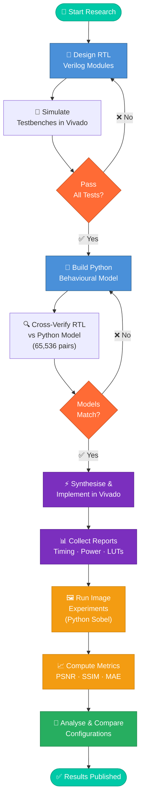
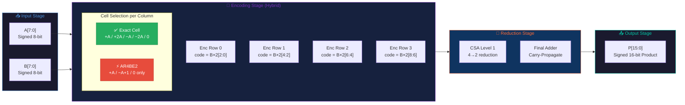
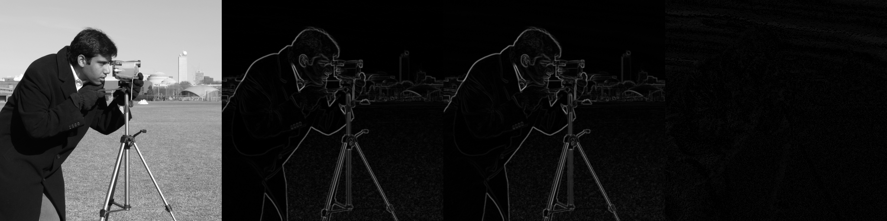
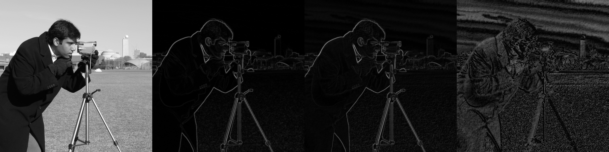

<div align="center">


<br/><br/>

# 🔬 Approximate Radix-4 Booth Multiplier
## FPGA Evaluation &amp; Image Quality Analysis

> **Evaluating approximate Radix-4 Booth encoding multipliers on Xilinx FPGA —**  
> trading arithmetic precision for hardware efficiency, validated through  
> exhaustive error analysis and 5×5 Sobel edge-detection image quality metrics.

<br/>

[](https://github.com/itzzsamy000/FPGA-Evaluation)
[](https://github.com/itzzsamy000/FPGA-Evaluation/stargazers)

</div>

---

## 📋 Table of Contents

| # | Section |
|---|---------|
| 1 | [🧠 Overview](#-overview) |
| 2 | [🏗️ System Architecture Flowchart](#️-system-architecture-flowchart) |
| 3 | [🔄 Research Methodology Flowchart](#-research-methodology-flowchart) |
| 4 | [⚙️ Multiplier Design Flowchart](#️-multiplier-design-flowchart) |
| 5 | [📊 Key Results](#-key-results) |
| 6 | [🖼️ Visual Results — Sobel Edge Detection](#️-visual-results--sobel-edge-detection) |
| 7 | [🗂️ Repository Structure](#️-repository-structure) |
| 8 | [🚀 Installation & Setup](#-installation--setup) |
| 9 | [▶️ Running the Scripts](#️-running-the-scripts) |
| 10 | [⚠️ Limitations](#️-limitations) |

---

## 🧠 Overview

<div align="center">

| Property | Details |
|----------|---------|
| 🎯 **Goal** | Evaluate approximate Booth multipliers: area vs accuracy trade-off |
| 🔢 **Inputs** | Signed 8-bit × Signed 8-bit → Signed 16-bit output |
| 🏭 **Toolchain** | Xilinx Vivado 2026.1 |
| 💡 **Device** | xczu7ev-ffvc1156-2-e (Zynq UltraScale+) |
| 🐍 **Python** | NumPy · scikit-image · Pillow |
| ✅ **Verification** | Exhaustive — all 65,536 signed input pairs |

</div>

This project implements and evaluates **hybrid approximate Radix-4 Booth multipliers** by replacing exact Booth encoding cells with two approximate variants in the lower-significance columns:

<div align="center">

| Cell | Type | Behaviour |
|------|------|-----------|
| **AR4BE1** | Middle-tier approximation | Drops `×2` selection; treats `±2A` as `±A` |
| **AR4BE2** | Low-tier approximation | Further simplifies; treats `0` case as `±A` |
| **Exact** | Full precision | Standard Radix-4 Booth encoding |

</div>

Three configurations are compared against an **exact CSA baseline**:

<div align="center">

```
┌─────────────┬──────────────────────────────────────────────┐
│ Config      │ Column Split                                 │
├─────────────┼──────────────────────────────────────────────┤
│ Exact CSA   │ All 16 columns exact                         │
│ H10/M0/L6   │ 10 high exact + 6 low AR4BE2                 │
│ H12/M0/L4   │ 12 high exact + 4 low AR4BE2                 │
└─────────────┴──────────────────────────────────────────────┘
```

</div>

---

## 🏗️ System Architecture Flowchart



---

## 🔄 Research Methodology Flowchart



---

## ⚙️ Multiplier Design Flowchart



---

## 📊 Key Results

### ⚡ Hardware & Arithmetic Performance

<div align="center">

| Metric | 🟢 Exact CSA | 🟡 H10/M0/L6 | 🟠 H12/M0/L4 |
|--------|:-----------:|:------------:|:------------:|
| **LUTs** | 74 | **72** ⬇️ | 76 ⬆️ |
| **CARRY8** | 2 | 2 | 2 |
| **Routed delay (ns)** | 6.533 | **6.466** ⚡ | **6.465** ⚡ |
| **Est. dynamic power (mW)** | 20 | 20 | 21 |
| **Error rate (%)** | **0** ✅ | 60.94 ❌ | 42.19 ⚠️ |
| **Mean absolute error** | **0** ✅ | 15.25 | 2.43 |
| **Max absolute error** | **0** ✅ | 125 | 17 |

> All arithmetic metrics cover the complete set of **65,536 signed input pairs (−128 to +127)**.

</div>

### 🖼️ Image Quality (5×5 Sobel, vs. Exact Reference)

<div align="center">

| Image | 🟡 H10 PSNR (dB) | 🟠 H12 PSNR (dB) | 🟡 H10 SSIM | 🟠 H12 SSIM |
|-------|:----------------:|:----------------:|:-----------:|:-----------:|
| 📷 Camera | 33.86 | **50.82** | 0.657 | **0.980** |
| 🌳 Test1 (Tree) | 33.19 | **51.44** | 0.729 | **0.990** |
| 🏙️ Test2 (City) | 33.04 | **48.88** | 0.640 | **0.945** |

> Higher PSNR and SSIM = better image quality (closer to exact output).

</div>

---

## 🖼️ Visual Results — Sobel Edge Detection

> Each comparison strip shows: **Input Image → Exact Sobel → Approximate Sobel → Difference ×8**

---

### 📷 Camera Image

<table>
<tr>
<td align="center"><b>🟡 H10/M0/L6 Configuration</b><br/><sub>PSNR: 33.86 dB · SSIM: 0.657</sub></td>
</tr>
<tr>
<td>


</td>
</tr>
<tr>
<td align="center"><b>🟠 H12/M0/L4 Configuration</b><br/><sub>PSNR: 50.82 dB · SSIM: 0.980</sub></td>
</tr>
<tr>
<td>



</td>
</tr>
</table>

---

### 🌳 Test1 — Tree Image

<table>
<tr>
<td align="center"><b>🟡 H10/M0/L6 Configuration</b><br/><sub>PSNR: 33.19 dB · SSIM: 0.729</sub></td>
</tr>
<tr>
<td>


</td>
</tr>
<tr>
<td align="center"><b>🟠 H12/M0/L4 Configuration</b><br/><sub>PSNR: 51.44 dB · SSIM: 0.990</sub></td>
</tr>
<tr>
<td>


</td>
</tr>
</table>

---

### 🏙️ Test2 — City Image

<table>
<tr>
<td align="center"><b>🟡 H10/M0/L6 Configuration</b><br/><sub>PSNR: 33.04 dB · SSIM: 0.640</sub></td>
</tr>
<tr>
<td>


</td>
</tr>
<tr>
<td align="center"><b>🟠 H12/M0/L4 Configuration</b><br/><sub>PSNR: 48.88 dB · SSIM: 0.945</sub></td>
</tr>
<tr>
<td>


</td>
</tr>
</table>

---

### 🔬 Python Error Comparison Plot

<div align="center">



*Python model error distribution comparison across multiplier configurations*

</div>

---

## 🗂️ Repository Structure

```
booth_approx_research/
│
├── 📄 booth_approx_research.xpr          ← Vivado project file
│
├── 📁 booth_approx_research.srcs/
│   ├── 📁 sources_1/new/                 ← RTL Design Sources (Verilog)
│   │   ├── ar4be1.v                      ← Approximate encoder 1
│   │   ├── ar4be2.v                      ← Approximate encoder 2
│   │   ├── booth8_cell_exact.v           ← Exact Booth cell
│   │   ├── booth8_hybrid_enc.v           ← Hybrid encoder multiplier
│   │   ├── booth8_hybrid_csa.v           ← Hybrid CSA multiplier
│   │   ├── booth_exact_bit.v             ← Exact bit-level Booth
│   │   ├── sobel5x5_booth.v              ← Sobel (Booth multiply)
│   │   └── sobel5x5_exact_shiftadd.v    ← Sobel exact reference
│   │
│   ├── 📁 sim_1/new/                     ← Testbenches
│   │   ├── tb_ar4be1.v
│   │   ├── tb_ar4be2.v
│   │   ├── tb_booth8_cell_exact.v
│   │   ├── tb_booth8_hybrid_csa.v
│   │   ├── tb_booth8_hybrid_enc.v
│   │   ├── tb_booth8_power.v
│   │   ├── tb_booth_exact_bit.v
│   │   ├── tb_sobel5x5_booth.v
│   │   └── tb_sobel5x5_exact_shiftadd.v
│   │
│   └── 📁 constrs_1/new/                ← Timing Constraints (XDC)
│       ├── booth_timing.xdc
│       └── sobel_timing.xdc
│
├── 📁 Script/                            ← Python Scripts
│   ├── booth_model.py                    ← Behavioural model + error metrics
│   ├── compare_rtl.py                    ← RTL vs Python comparison
│   ├── image_experiment.py               ← Image-quality evaluation
│   └── verify_sobel_shiftadd.py         ← Sobel verification
│
├── 📁 images/                            ← Input Test Images
│   ├── input.png
│   ├── test1.png
│   └── test2.png
│
├── 📁 results/                           ← All Experimental Results
│   ├── CSA_Exact/                        ← Exact baseline reports
│   ├── CSA_H10_M0_L6/                   ← H10 CSA reports
│   ├── CSA_H12_M0_L4/                   ← H12 CSA reports
│   ├── image_H10_M0_L6_*/               ← H10 Sobel image outputs
│   ├── image_H12_M0_L4_*/               ← H12 Sobel image outputs
│   ├── python_model/                     ← Python error CSVs
│   └── timing_synth.rpt                  ← Global timing report
│
└── 📁 docs/
    └── results_summary.md               ← Summary of all results
```

---

## 🚀 Installation & Setup

### Prerequisites

<div align="center">

| Tool | Purpose | Version |
|------|---------|---------|
| 🔴 **Xilinx Vivado** | RTL simulation & synthesis | 2026.1+ |
| 🐍 **Python** | Behavioural model & evaluation | 3.9+ |

</div>

### Python Dependencies

```bash
pip install numpy scikit-image pillow
```

### Clone the Repository

```bash
git clone https://github.com/itzzsamy000/FPGA-Evaluation.git
cd FPGA-Evaluation
```

---

## ▶️ Running the Scripts

### 🐍 Python Behavioural Model

```bash
# Exhaustive error-metric verification (all 65,536 pairs)
python Script/booth_model.py

# RTL vs Python cross-verification
python Script/compare_rtl.py

# 5x5 Sobel image-quality evaluation
python Script/image_experiment.py

# Sobel shift-add verification
python Script/verify_sobel_shiftadd.py
```

### 🔴 Vivado RTL Simulation

```
1. Open  booth_approx_research.xpr  in Vivado
2. Select a testbench from sim_1/new/
   e.g.  tb_booth8_hybrid_enc.v
3. Run Behavioural Simulation
```

### 🔴 Synthesis & Implementation

```
1. Open the project in Vivado
2. Run: Synthesis → Implementation
3. Constraints: constrs_1/new/*.xdc
4. Reports: results/ directory
```

---

## ⚠️ Limitations

<div align="center">

| ⚠️ Limitation | Details |
|--------------|---------|
| 🔌 **Power** | Estimates only — no physical board measurement |
| 💻 **Image processing** | Evaluated in Python software, not on-chip |
| 🖼️ **Images** | Only 3 test images evaluated |
| 📐 **Architecture** | Encoder approximation with exact reduction only |
| 📚 **Publication** | Novelty vs. prior art not formally established |

</div>

---

<div align="center">

**🔬 Research Project · Approximate Computing · FPGA · Booth Multiplier**


</div>